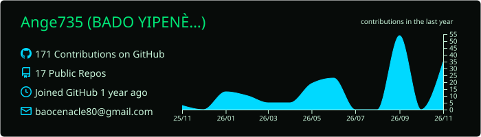
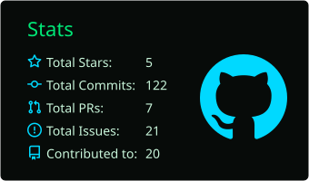
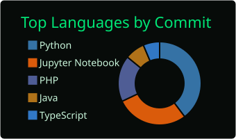

`> AI · DATA · CYBER`

## À propos

Je suis **AI/ML Engineer chez GO AI CORP** depuis juillet 2026 et élève ingénieur en **Data Science & Intelligence Artificielle** à l'ENSAM Meknès (2ᵉ année du cycle ingénieur, Bac+4 en cours).

Je construis des systèmes d'IA qui transforment des données brutes et des documents en décisions : collecte de données à grande échelle, OCR, extraction d'informations par LLM, RAG, et modèles de Machine Learning, de la préparation des données jusqu'à l'évaluation.

- 🏆 **1er prix**, Compétition Data IA, GO AI ACADEMY (2025)
- 📜 Machine Learning Specialization (Stanford / Coursera), Mathematics for ML & Data Science (DeepLearning.AI)

## Expérience

### AI/ML Engineer · GO AI CORP · *juillet 2026, en poste*

**AFRIKOPPS**, plateforme multi-pays d'intelligence économique qui collecte et analyse les appels d'offres, les offres d'emploi et les stages en Afrique *(dépôt privé)*.

- **Collecte de données** : plus de 20 sources de scraping (portails ARCOP, ARMP, DGCMEF, UEMOA, BCEAO...), extraction des résultats d'attribution des marchés publics.
- **Qualité des données** : dédoublonnage par double empreinte SHA-256, gazetteers de normalisation géographique, classification sectorielle.
- **OCR et Document Intelligence** : repli OCR (Tesseract) sur les avis scannés, analyse des dossiers de soumission, détection des signatures et des cachets.
- **Moteur de conformité (LLM)** : *Requirement Extractor* qui extrait les critères d'un dossier d'appel d'offres sous forme structurée, avec un jeu de référence pour mesurer la qualité de l'extraction.
- **Backend** : architecture multi-tenant, bus d'événements Redis Streams, files Celery, migrations Alembic.

`Python` `FastAPI` `Celery` `Redis` `PostgreSQL` `SQLAlchemy` `Docker` `Tesseract` `LLM` `Next.js`

## Projets à la une

| Projet | Description | Stack |
|---|---|---|
| 🏥 [**SEHHA**](https://github.com/Ange735/sehha) | Moteur IA de triage médical (Youth Nexus Cyber AI Challenge) : agent conversationnel qui mène l'entretien clinique, triage CCMU 1 à 5 appuyé sur un RAG de protocoles médicaux, bascule LLM cloud / local. | `FastAPI` `LLM` `ChromaDB` `Groq` `Ollama` |
| 💸 [**Fraude Mobile Money**](https://github.com/Ange735/mobile-money-fraude-kmeans) | Détection non supervisée de fraudes rares (< 2 %) sur 8 130 transactions : feature engineering, K-means, score d'anomalie et règles d'alerte explicables. | `scikit-learn` `Pandas` |
| 🦯 [**Smart Blind Assistant**](https://github.com/Ange735/Smart_Blind_Assistant) | Application mobile d'assistance pour personnes malvoyantes : détection d'objets et d'obstacles, description vocale, commandes vocales. | `Flutter` `FastAPI` `YOLO` `STT/TTS` |
| 🏛️ [**Visual RAG Tourisme Maroc**](https://github.com/Ange735/visual-rag-tourisme-maroc) | Reconnaissance de monuments marocains par CLIP et génération d'une fiche touristique par un LLM local. | `CLIP` `ChromaDB` `Ollama` |
| 🚑 [**Prédiction des passages aux urgences**](https://github.com/Ange735/Prediction_PassageAuxUrgences) | Prévision du flux journalier de patients de l'Hôpital Mohammed V de Meknès sur données réelles. | `ARIMA` `Prophet` `LSTM` |
| ✋ [**Hand Shape Manipulator**](https://github.com/Ange735/hand-shape-manipulator) | Manipulation de formes géométriques avec les doigts via la webcam. | `OpenCV` `MediaPipe` |

<b>Travaux pratiques et labs</b>

 

- [machine-learning-tps](https://github.com/Ange735/machine-learning-tps) : régression, arbres, random forest, SVR, clustering, boosting (from scratch + scikit-learn)
- [time-series-labs](https://github.com/Ange735/time-series-labs) : ARIMA, auto-ARIMA, prévision de consommation électrique (LSTM, CNN-LSTM)
- [nlp-labs](https://github.com/Ange735/nlp-labs) : tokenisation, détection de sarcasme, analyse de sentiment en français avec dashboard Flask
- [computer-vision-tps](https://github.com/Ange735/computer-vision-tps) : prétraitement OpenCV, MediaPipe, détection de couleurs
- [roboflow-streamlit-apps](https://github.com/Ange735/roboflow-streamlit-apps) : détection et classification d'objets avec Roboflow et Streamlit
- [java-poo-tps](https://github.com/Ange735/java-poo-tps) : programmation orientée objet en Java

## Cybersécurité

Parcours **Ethical Hacking & Sécurité Offensive** de GO AI ACADEMY *(en cours)*, avec un cas pratique à chaque séance, toujours dans un cadre mandaté et légal.

- **Réseau et analyse de trafic** : TCP/IP, DNS, TLS/HTTPS (SSL stripping, HSTS), reconnaissance avec nmap, dig et whois, analyse Wireshark d'un cas d'exfiltration réel (265 000 paquets) et extraction d'IoC.
- **Interception et défense réseau** : empoisonnement ARP et détournement de session en lab, VPN et Zero Trust, NGFW/IDS/IPS, honeypot et Threat Intelligence.
- **OSINT** : reconnaissance passive et active, métadonnées EXIF, Shodan et Censys, rédaction de rapports d'investigation.
- **Exploitation et post-exploitation** : Metasploit, msfvenom, Meterpreter, escalade de privilèges sur services vulnérables (FTP, SMB, HTTP, Telnet).
- **Sécurité Web et API (OWASP)** : Burp Suite, injection SQL (manuelle et sqlmap), XSS, SSRF, CSRF, contrôle d'accès, attaques REST/GraphQL (BOLA, mass assignment), avec un correctif *secure coding* pour chaque faille.
- **Méthode** : documentation rigoureuse des preuves (fiches IoC, chaîne de preuve), cadre juridique (UEMOA, conventions de Malabo et de Budapest), lab virtualisé isolé.

## Compétences

**IA, Machine Learning et Deep Learning** 

**LLM, NLP et RAG** 

**Computer Vision et documents** 

**Données, backend et outils** 

**Cybersécurité** 

**Autres langages** 

## Statistiques GitHub

 

<picture>
  <source media="(prefers-color-scheme: dark)" srcset="https://raw.githubusercontent.com/Ange735/Ange735/output/github-snake-dark.svg"/>
  <source media="(prefers-color-scheme: light)" srcset="https://raw.githubusercontent.com/Ange735/Ange735/output/github-snake.svg"/>
  
</picture>

 

*Ouvert aux collaborations sur des projets IA, ML, LLM et Computer Vision.* 
<a href="https://www.linkedin.com/in/ange-bado">LinkedIn</a> · <a href="mailto:baocenacle80@gmail.com">Email</a>

